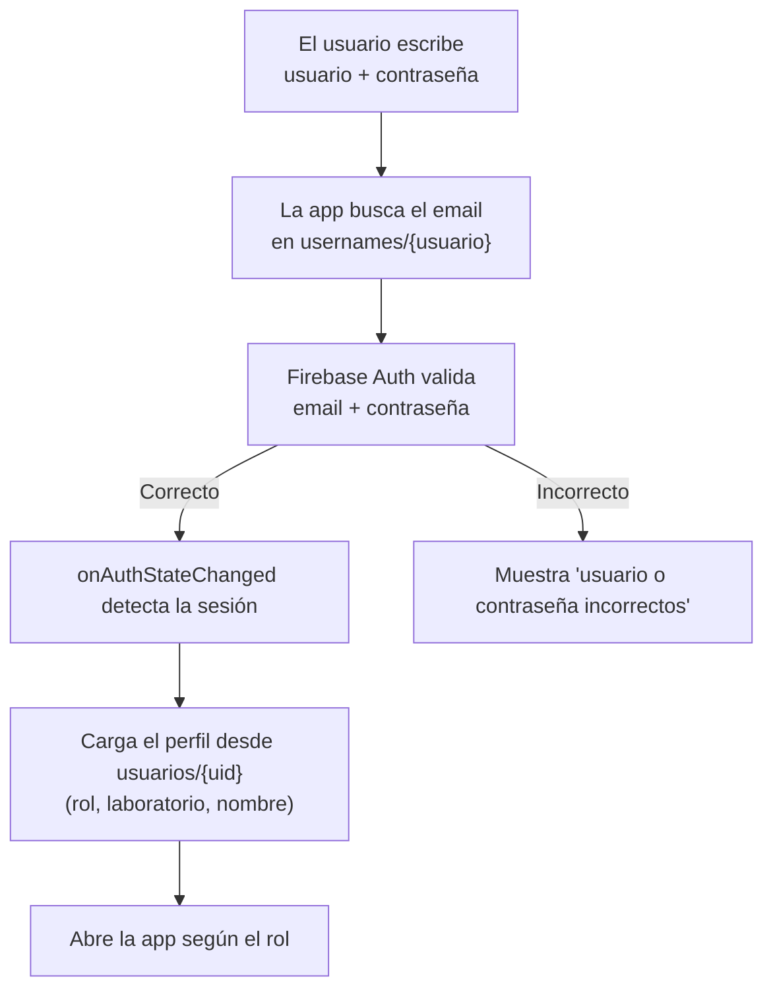
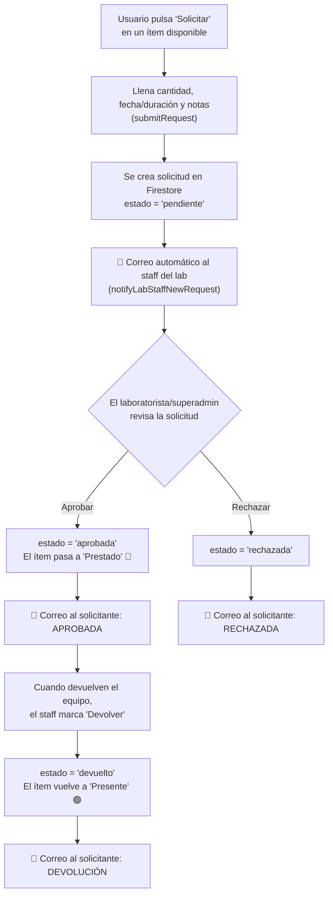

# 🏗️ Arquitectura de App Inventory — Guía para entender y exponer

Este documento explica **cómo está construida App Inventory de punta a punta**: desde
la autenticación hasta el sistema de préstamos. Está pensado para que puedas **aprender
el funcionamiento y exponerlo con buenas bases**. Cada sección explica el *qué*, el *cómo*
y, sobre todo, el *por qué*.

---

## 1. ¿Qué es App Inventory?

App Inventory es un **sistema web de gestión de inventario para laboratorios** de UNISANGIL
(Sede Yopal). Permite llevar el control de materiales y equipos de varios laboratorios,
gestionar usuarios con distintos permisos, y administrar un **flujo de préstamos** de equipos.

**Características clave:**
- Multi-laboratorio con inventarios independientes.
- Tres roles: superadministrador, laboratorista y usuario.
- Préstamos con solicitud → aprobación → devolución.
- Notificaciones por correo.
- Funciona offline y es **instalable como app** en el celular (PWA).

---

## 2. La idea central: una app "sin servidor propio"

La decisión arquitectónica más importante es que **no hay un servidor backend tradicional**
(no hay PHP, Node, Java, ni una base de datos que administremos nosotros). En su lugar:

```
┌─────────────────────────────┐        ┌──────────────────────────────┐
│   NAVEGADOR DEL USUARIO      │        │      GOOGLE FIREBASE          │
│  (todo el código corre aquí) │        │  (backend como servicio)     │
│                             │  ◄────► │                              │
│  • HTML + CSS + JavaScript  │        │  • Firebase Auth (identidad) │
│  • Lógica de la aplicación  │        │  • Firestore (base de datos) │
│  • Interfaz de usuario      │        │  • Reglas de seguridad       │
└─────────────────────────────┘        └──────────────────────────────┘
          │                                         ▲
          │ correos                                 │ hosting del sitio
          ▼                                         │
    ┌───────────┐                        ┌──────────────────┐
    │  EmailJS  │                        │  GitHub Pages    │
    └───────────┘                        └──────────────────┘
```

| Pieza | Rol | Por qué |
|-------|-----|---------|
| **HTML/CSS/JS** | Toda la app (interfaz + lógica) corre en el navegador | Simple, sin servidor que mantener |
| **Firebase Auth** | Identidad: quién es cada usuario | Autenticación robusta y estándar sin programar un backend |
| **Firestore** | Base de datos en la nube, en tiempo real | Sincroniza automáticamente entre dispositivos |
| **Reglas de Firestore** | Seguridad: qué puede hacer cada quien | **Se ejecutan en el servidor de Google**, no se pueden saltar |
| **EmailJS** | Envío de correos desde el navegador | Notificaciones sin servidor de correo propio |
| **GitHub Pages** | Hospeda el sitio (archivos estáticos) | Gratuito y con HTTPS |

> 🎤 **Para exponer:** "App Inventory usa una arquitectura *serverless*: el cliente contiene
> la lógica, y Firebase provee identidad, base de datos y seguridad. Esto elimina el costo y
> la complejidad de administrar un servidor, sin sacrificar la seguridad, porque las reglas
> de acceso se validan del lado del servidor de Google."

---

## 3. Organización del código

El proyecto está organizado por áreas para que sea mantenible:

```
index.html              → Estructura HTML (carga el CSS y los JS)
css/styles.css          → Todos los estilos
js/
  01-config.js          → Datos base, estado global, roles, config de Firebase/EmailJS
  02-storage.js         → Guardado (localStorage + Firestore) y sincronización
  03-auth.js            → Autenticación (Firebase Auth) y bitácora de auditoría
  04-ui-state.js        → Indicador de sincronización y selección masiva
  05-seed-data.js       → Datos iniciales de materiales y equipos
  06-rendering.js       → Dibujado de las vistas en pantalla
  07-labs.js            → Gestión de laboratorios (solo superadmin)
  08-navigation.js      → Navegación, edición en línea y ventanas modales
  09-inventory-tools.js → Exportar CSV, vista móvil, códigos, ubicaciones
  10-login-users.js     → Pantalla de login y gestión de usuarios
  11-loans.js           → Sistema de préstamos y notificaciones por correo
  12-backup-print.js    → Respaldo, impresión y bitácora
  13-init.js            → Arranque de la app
firestore.rules         → Reglas de seguridad (se publican en Firebase)
manifest.webmanifest    → Hace la app instalable (PWA)
sw.js                   → Service worker (funcionamiento offline)
```

> **Detalle técnico:** los archivos `js/` son *scripts clásicos* cargados en orden, que
> **comparten un único espacio global**. Por eso una función definida en un archivo puede
> llamarse desde el HTML (`onclick="doLogin()"`) o desde otro archivo. El orden importa:
> `01` prepara la configuración y `13` arranca la app al final.

---

## 4. Autenticación — ¿cómo sabe la app quién eres?

### 4.1 El concepto
La **autenticación** responde a la pregunta *"¿quién eres?"*. App Inventory usa **Firebase
Authentication** con correo + contraseña. Firebase guarda las contraseñas de forma segura
(cifradas, nunca en texto plano) y nos da una **sesión** cuando el usuario inicia correctamente.

### 4.2 El detalle especial: login por *nombre de usuario*
Firebase Auth funciona con **email + contraseña**, pero App Inventory permite entrar con un
**nombre de usuario** (ej. `admin`), que es más cómodo. ¿Cómo se concilian ambas cosas?

Con una colección llamada `usernames` que **traduce** el nombre de usuario a su email:

```
usernames/admin  →  { email: "admin@appinventory.local", uid: "YjjzjbQx..." }
```

Así, el flujo de inicio de sesión es:



**Funciones clave** (en `js/10-login-users.js` y `js/03-auth.js`):
- `usernameToEmail(usuario)` → busca el email en el mapa `usernames`.
- `doLogin()` → resuelve el email y llama a `signInWithEmailAndPassword`.
- `initAuthListener()` → escucha `onAuthStateChanged`, la **puerta única** de la app: se
  dispara al cargar la página, al iniciar sesión y al cerrarla.
- `enterApp(uid, datos)` → carga el perfil y muestra la interfaz según el rol.

### 4.3 Cuentas sin correo real (como el superadmin)
Firebase siempre necesita un email como identificador, pero el superadmin no tiene por qué
tener un buzón real. La solución: un **email sintético** como `admin@appinventory.local`
(el dominio `.local` nunca es real). El usuario entra solo con su nombre de usuario; el email
sintético es un detalle interno que nunca ve.

> 🎤 **Para exponer:** "El login por nombre de usuario se logra con una tabla de traducción
> `usernames → email`. La sesión no se maneja con trucos caseros, sino con el mecanismo oficial
> de Firebase (`onAuthStateChanged`), que es la única puerta de entrada a la aplicación."

---

## 5. Seguridad — el corazón del sistema (y tu mejor punto para exponer)

### 5.1 Autenticación ≠ Autorización
- **Autenticación** = *¿quién eres?* (Firebase Auth lo resuelve).
- **Autorización** = *¿qué puedes hacer?* (las **reglas de Firestore** lo resuelven).

### 5.2 Por qué la seguridad NO puede estar solo en el navegador
Todo lo que corre en el navegador el usuario lo puede ver y modificar (abriendo las
herramientas de desarrollador). Si la regla "solo el laboratorista puede editar" estuviera
solo en el JavaScript del cliente, **cualquiera podría saltársela**. Por eso la verdadera
barrera está en las **reglas de Firestore**, que se ejecutan en los servidores de Google y
**no se pueden modificar desde el cliente**.

### 5.3 Cómo validan los roles las reglas
Los roles viven en `usuarios/{uid}`. Cuando alguien intenta escribir, la regla **lee el perfil
del que hace la petición** y comprueba su rol. Ejemplo real (simplificado) de `firestore.rules`:

```javascript
// El inventario lo escribe el superadmin, o el laboratorista SOLO de su propio lab
match /inventario/{labId} {
  allow read: if isSignedIn();
  allow write: if isSuperadmin() || (isLab() && myLab() == labId);
}
```

Donde `isSuperadmin()` consulta el documento `usuarios/{uid}` del solicitante y verifica
`role == "superadmin"`. **Esto ocurre en el servidor en cada operación.**

> 🎤 **Para exponer (punto fuerte):** "La seguridad de App Inventory no depende del navegador.
> Los permisos se validan en el servidor mediante las *reglas de seguridad de Firestore*: ni
> siquiera abriendo la consola del navegador se puede alterar un inventario ajeno o cambiarse
> el rol a uno mismo. Un usuario sin sesión no puede leer ni escribir absolutamente nada."

### 5.4 Nota histórica (mejora de ingeniería que puedes destacar)
La primera versión usaba autenticación *casera* (guardaba contraseñas cifradas en la base de
datos y comparaba en el navegador), lo que obligaba a dejar la base de datos abierta. Eso era
un riesgo grave. Se **migró a Firebase Auth + reglas de Firestore**, cerrando el acceso no
autorizado. (Detalle completo en [`SEGURIDAD.md`](SEGURIDAD.md).)

---

## 6. Modelo de datos (las colecciones de Firestore)

Firestore es una base de datos de **documentos** organizados en **colecciones**:

| Colección | Qué guarda | Documento identificado por |
|-----------|------------|----------------------------|
| `usuarios/{uid}` | Perfil: nombre, email, **rol**, laboratorio asignado | El `uid` de Firebase Auth |
| `usernames/{usuario}` | Traducción nombre de usuario → email (para el login) | El nombre de usuario |
| `laboratorios/{labId}` | Nombre, código y tipo de préstamo del laboratorio | El id del laboratorio |
| `inventario/{labId}` | **Todos los ítems** de ese laboratorio + ubicaciones | El id del laboratorio |
| `solicitudes/{id}` | Préstamos (solicitud, estado, fechas) | Id automático |
| `historial/{id}` | Bitácora de auditoría (quién hizo qué) | Id automático |

**Un detalle interesante:** el inventario de cada laboratorio se guarda como **un solo
documento** (`inventario/{labId}`) que contiene un arreglo `items` con todos los objetos, más
las ubicaciones personalizadas. Es simple y eficiente para inventarios de tamaño medio.

---

## 7. Roles y permisos

| Rol | Puede | No puede |
|-----|-------|----------|
| **Superadministrador** | Todo: crear/eliminar laboratorios, administrar usuarios, ver y editar todos los inventarios | — |
| **Laboratorista** | Gestionar el inventario de **su** laboratorio, aprobar/rechazar préstamos de su lab | Tocar otros laboratorios, cambiar roles |
| **Usuario** | Consultar inventarios y **solicitar** préstamos | Editar inventario, aprobar préstamos |

Estos permisos se reflejan **en dos lugares**:
1. En la **interfaz** (`js/06-rendering.js`, función `canEdit()`): oculta botones que el usuario
   no debería usar. Esto es por comodidad, no por seguridad.
2. En las **reglas de Firestore**: esta es la barrera real e infranqueable.

---

## 8. El inventario (materiales y equipos)

Cada laboratorio tiene dos **secciones**: **Materiales** y **Equipos**. Dentro, los ítems se
organizan por **ubicación** (ej. "Escritorio", "Gabinete") y **cajón/módulo**.

Cada ítem tiene un **estado** con color:

| Estado | Color | Significado |
|--------|-------|-------------|
| Presente | 🟢 Verde | Disponible en su lugar |
| Desgastado | 🟡 Amarillo | Funciona pero con desgaste |
| Dañado | 🔴 Rojo | Necesita reparación |
| No Préstamo | 🟣 Morado | No disponible para préstamo |
| Faltante | ⚫ Gris | No se encuentra |
| Prestado | 🔵 Azul | En préstamo activo |

El estado **Prestado** es especial: lo pone automáticamente el sistema cuando se aprueba un
préstamo (ver sección 9).

---

## 9. Sistema de préstamos (flujo completo)

Este es uno de los procesos más importantes. Conecta usuarios, inventario y correos.



**Puntos clave del flujo:**
- Hay dos **modalidades de préstamo** según el laboratorio: por **horas** o por **días**
  (campo `loanType` del laboratorio).
- Al **aprobar**, el ítem cambia **solo** a "Prestado" y se anota a quién y hasta cuándo
  (`updateSolicitud`, en `js/11-loans.js:375`).
- Al **devolver**, el ítem vuelve **solo** a "Presente".
- Cada cambio de estado dispara un **correo automático** al solicitante.
- Cada rol ve las solicitudes que le corresponden (`getSolicitudesForRole`): el usuario ve las
  suyas; el laboratorista, las de su lab; el superadmin, todas.

**Estados de una solicitud:** `pendiente` → `aprobada` / `rechazada`; y `aprobada` → `devuelto`.

---

## 10. Notificaciones por correo (EmailJS)

App Inventory envía correos **sin un servidor de correo propio**, usando **EmailJS**: un
servicio que, con una plantilla y unas claves públicas, envía correos directamente desde el
navegador.

- **Configuración** (claves + inicialización): `js/01-config.js`.
- **Envío** (`js/11-loans.js`):
  - `sendEmailNotification(solicitud, estado)` → avisa al **solicitante** cuando su préstamo es
    aprobado, rechazado o devuelto.
  - `notifyLabStaffNewRequest(solicitud)` → avisa al **staff** del laboratorio cuando llega una
    solicitud nueva.
  - `sendEmail(...)` → la función base que llama a `emailjs.send(...)`.

---

## 11. Sincronización y modo offline

App Inventory sigue funcionando sin internet gracias a **dos capas** de almacenamiento:

1. **Firestore con persistencia offline** (`enablePersistence`): guarda una copia local de la
   base de datos y **sincroniza automáticamente** al reconectar.
2. **localStorage** (`js/02-storage.js`): copia de respaldo del inventario en el navegador.

Un **indicador de sincronización** (`js/04-ui-state.js`) le muestra al usuario si está en
línea, sincronizando o sin conexión.

> 🎤 **Para exponer:** "Si el laboratorio se queda sin internet, la app sigue operando con la
> copia local y, al volver la conexión, Firestore sincroniza los cambios automáticamente."

---

## 12. PWA — instalable como una app

App Inventory es una **Progressive Web App**: una página web que se **instala** en el celular
como si fuera una app nativa. Esto lo logran tres piezas:

- `manifest.webmanifest` → nombre, icono y colores; le dice al sistema que es instalable.
- `sw.js` (**service worker**) → un script que corre en segundo plano, guarda la app en caché
  y permite que **abra sin internet**.
- Iconos en `icons/`.

Resultado: en Android (Chrome) aparece "Instalar aplicación"; en iPhone (Safari), "Añadir a
pantalla de inicio". Queda con su icono y abre en pantalla completa.

---

## 13. Recorrido de una acción, de principio a fin (ejemplo integrador)

Para amarrar todo, sigamos *"un laboratorista aprueba un préstamo"*:

1. **Interfaz** (`06-rendering.js`): se dibuja el botón "Aprobar" porque `canEdit()` es verdadero.
2. **Acción** (`11-loans.js` → `updateSolicitud`): se actualiza la solicitud a `aprobada` y el
   ítem a `Prestado`.
3. **Seguridad** (`firestore.rules`): Firestore comprueba en el servidor que quien escribe es
   laboratorista **de ese laboratorio**. Si no, rechaza la operación.
4. **Datos** (`02-storage.js`): el cambio se guarda en Firestore y se sincroniza a todos los
   dispositivos en tiempo real.
5. **Notificación** (`11-loans.js` → `sendEmailNotification`): EmailJS envía el correo al
   solicitante.
6. **Auditoría** (`03-auth.js` → `logAction`): se registra la acción en la bitácora `historial`.

---

## 14. Glosario rápido

| Término | Significado sencillo |
|---------|----------------------|
| **SPA** | *Single Page Application*: una sola página que cambia su contenido sin recargar |
| **Serverless** | Sin servidor propio; se usan servicios en la nube (Firebase) |
| **Autenticación** | Verificar *quién* es el usuario |
| **Autorización** | Decidir *qué* puede hacer el usuario |
| **Firestore** | Base de datos de documentos en la nube, en tiempo real |
| **Reglas de seguridad** | Código en el servidor que decide qué lectura/escritura se permite |
| **uid** | Identificador único que Firebase da a cada cuenta |
| **PWA** | Web instalable que funciona como app y offline |
| **Service worker** | Script en segundo plano que cachea la app para usarla sin internet |

---

## 15. Resumen en una frase

> **App Inventory es una aplicación web *serverless* que usa Firebase Authentication para la
> identidad, Firestore para los datos en tiempo real, y reglas de seguridad del lado del
> servidor para proteger la información; sobre esa base ofrece gestión multi-laboratorio,
> control de inventario por estados y un flujo completo de préstamos con notificaciones por
> correo, todo empaquetado como una app instalable en el celular.**
